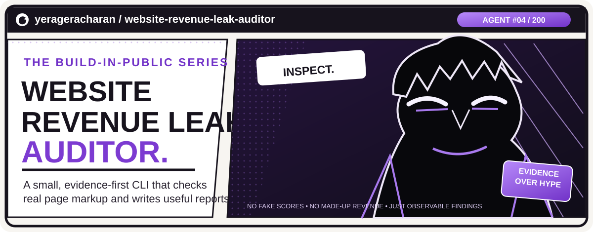
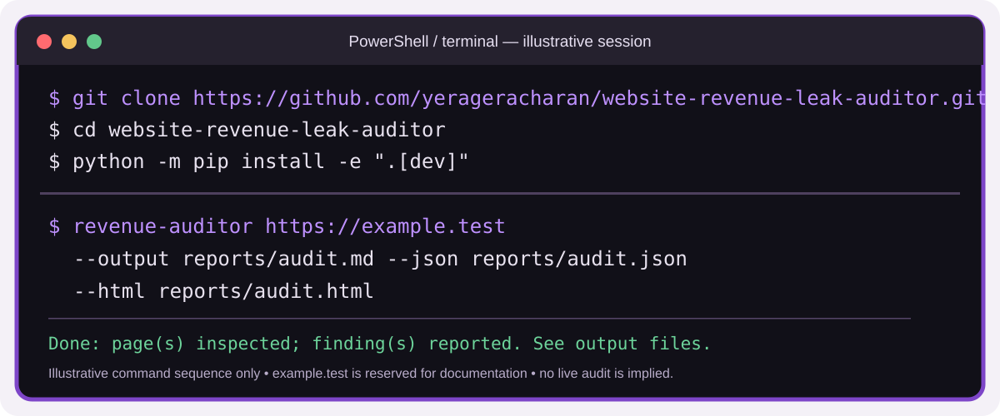
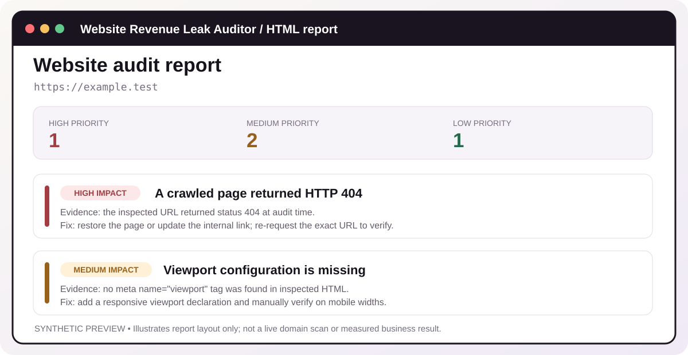
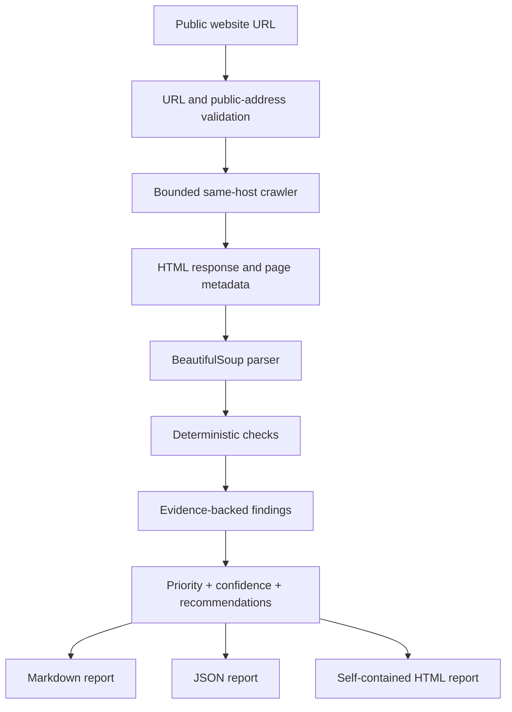

<div align="center">



[](https://github.com/yerageracharan/website-revenue-leak-auditor/actions/workflows/tests.yml)
[](https://www.python.org/)
[](LICENSE)
[](https://github.com/yerageracharan)

### 200 AI agents. 200 real problems. One build at a time.

**A website can get visitors and still lose the next click. This agent looks for the friction.**

[Quick start](#quick-start) · [What it checks](#what-it-checks) · [Example report](#example-report) · [Roadmap](#next-chapters)

</div>

---

## ◢ CASE FILE 04 — THE WEBSITE THAT LEAKS

> *The visitor arrives. The page loads. The button is nowhere. The link is broken. The visitor leaves.*
>
> **The problem might not be traffic. It might be what happens after the click.**

Website Revenue Leak Auditor is a small, evidence-first Python CLI that inspects a public website's static HTML, records observable problems, and turns them into a prioritised report with practical fixes.

It is built for developers, freelancers, agencies, and business owners who want a first-pass website review without pretending that an automated scan can read minds—or calculate lost revenue from a homepage.

**Current build:** a working static-HTML CLI. It crawls a bounded set of same-host pages and exports Markdown, JSON, and a self-contained HTML report.

<div align="center">

| <sub>THE INPUT</sub> | <sub>THE INVESTIGATION</sub> | <sub>THE OUTPUT</sub> |
|:---:|:---:|:---:|
| 🌐 A website URL | 🔎 Real HTML + deterministic checks | 📄 Findings + evidence + fixes |
| *"Look at this site."* | *"What can we verify?"* | *"Here's what to fix first."* |

</div>

<a id="what-it-checks"></a>\n\n## ⚡ CASE FILE 01 — WHAT THE AUDITOR CAN ACTUALLY SEE

| Investigation | What the current MVP checks | Why it can matter |
|---|---|---|
| **Page metadata** | Missing or unusually long title, missing meta description, missing canonical link | Search previews and page identity |
| **Content structure** | No H1 or multiple H1 elements | Page hierarchy and scanability |
| **Mobile signal** | Missing viewport meta tag | A reason to inspect the page at phone widths |
| **Image markup** | Images with no `alt` attribute | Screen-reader users may miss image information |
| **Conversion signal** | Common action words in links and buttons | A low-confidence clue that the next step may be hard to find |
| **Page availability** | Same-host pages that return HTTP 4xx or 5xx during the crawl | Visitors may reach a page that is unavailable |

Every finding carries the **page URL, evidence, impact priority, confidence, recommendation, and a way to verify the fix**.

<details>
<summary><strong>What those checks do NOT prove</strong> — open before making a client claim</summary>

- A missing viewport tag is not a full mobile usability test.
- An image without an `alt` attribute may be decorative; the current check does not judge alt-text quality.
- The CTA detector searches common words. It can miss icon-only buttons, custom labels, or actions rendered by JavaScript.
- A returned 404/500 is an observation made at audit time; transient failures can happen.
- An SEO metadata check does not predict rankings.
- An impact label is triage guidance—not a financial calculation or a promised conversion lift.

</details>

## 🎬 CASE FILE 02 — THE INVESTIGATION, PANEL BY PANEL

<div align="center">

<sub><strong>Terminal panel:</strong> the commands use the real CLI interface. The displayed output is an illustrative example, not a live scan.</sub>
</div>

### The run, explained

1. **You provide a URL.** The CLI accepts an HTTP or HTTPS URL.
2. **The safety gate checks the target.** It rejects embedded credentials, non-standard ports, local/private IP destinations, and unsupported schemes.
3. **The crawler investigates a small area.** It follows same-host HTML links, manually checks redirects, and respects page and response-size limits.
4. **The check engine reads the markup.** Deterministic Python checks inspect titles, descriptions, canonical links, headings, viewport metadata, image alt attributes, CTA wording, and HTTP statuses.
5. **The report generator assembles the evidence.** You get a prioritised Markdown report and optional JSON/HTML exports.

No LLM is required to produce the current findings. The facts come from the inspected responses and parsed HTML.

<a id="example-report"></a>\n\n## 🗂️ CASE FILE 03 — INSIDE THE AUDIT REPORT

<div align="center">

<sub><strong>Report panel:</strong> synthetic example.test data to show the layout. It is not a real website scan, score, or business result.</sub>
</div>

The CLI can write three formats from the same audit result:

| File | Use it for |
|---|---|
| `audit.md` | Read, review, edit, or attach to an issue |
| `audit.json` | Structured data for another script or future dashboard |
| `audit.html` | Self-contained, responsive report that can be opened in a browser and printed |

The HTML report uses no external JavaScript or CSS. Likely sensitive query values (for common names such as `token`, `key`, `password`, `auth`, and `session`) are redacted when reports are written. This is best-effort protection, not a substitute for keeping secrets out of URLs.

**Example report:** [Open the synthetic sample finding](examples/sample-audit-report.md).

<a id="quick-start"></a>\n\n## 🚀 YOUR FIRST AUDIT — THE 5-MINUTE ORIGIN STORY

<blockquote>
  <strong>Before you begin:</strong> Python 3.10+ is required. Only audit a website you own or have permission to assess. Use your own public website in place of the example URL.
</blockquote>

### Step 1 — Clone the repository

```bash
git clone https://github.com/yerageracharan/website-revenue-leak-auditor.git
cd website-revenue-leak-auditor
```

### Step 2 — Create a virtual environment

**Windows PowerShell**

```powershell
python -m venv .venv
.\.venv\Scripts\Activate.ps1
```

**macOS / Linux**

```bash
python3 -m venv .venv
source .venv/bin/activate
```

### Step 3 — Install the project

```bash
python -m pip install --upgrade pip
python -m pip install -e ".[dev]"
```

That installs the CLI, runtime dependencies, and development/test dependencies.

### Step 4 — Run your first audit

Replace `https://your-domain.com` with a public website you are authorised to inspect.

```bash
revenue-auditor https://your-domain.com
```

By default, the auditor inspects up to **5 pages**, uses a **10-second per-request timeout**, and writes `audit-report.md` in the current directory.

### Step 5 — Export all three report formats

**macOS / Linux / Git Bash**

```bash
revenue-auditor https://your-domain.com \
  --max-pages 8 \
  --timeout 10 \
  --output reports/audit.md \
  --json reports/audit.json \
  --html reports/audit.html
```

**Windows PowerShell**

```powershell
revenue-auditor https://your-domain.com --max-pages 8 --timeout 10 --output reports/audit.md --json reports/audit.json --html reports/audit.html
```

The `reports/` directory is created automatically when needed.

### Step 6 — Open the result

- Open `reports/audit.html` in your browser for the visual report.
- Open `reports/audit.md` for a Markdown version.
- Use `reports/audit.json` when you want structured findings.

**Windows PowerShell:** `Start-Process .\reports\audit.html`

**macOS:** `open reports/audit.html`

**Linux:** `xdg-open reports/audit.html`

### Step 7 — Run the tests

```bash
pytest
```

The test suite uses mocked HTTP and DNS responses; it does not need API keys or crawl live websites.

<details>
<summary><strong>CLI options — the control panel</strong></summary>

| Option | Default | Meaning |
|---|---:|---|
| `URL` | Required | Public HTTP(S) target |
| `--max-pages` | `5` | Pages to inspect; allowed range 1–15 |
| `--timeout` | `10` | Per-request timeout in seconds; allowed range 2–30 |
| `--output` | `audit-report.md` | Markdown report destination |
| `--json` | Off | Optional JSON report destination |
| `--html` | Off | Optional self-contained HTML report destination |
| `--version` | — | Print installed CLI version |
| `--help` | — | Show command help |

```bash
revenue-auditor --help
revenue-auditor --version
```

</details>

## 🧠 HOW THE MACHINE THINKS — ARCHITECTURE



### Project structure

```text
website-revenue-leak-auditor/
├── .claude/
│   └── skills/website-revenue-leak-auditor/
│       └── SKILL.md          # Claude Code skill for this project
├── .github/workflows/
│   └── tests.yml             # CI across supported Python versions
├── docs/
│   ├── assets/               # README manga + report visuals
│   └── SECURITY.md           # Threat model and known limitations
├── examples/
│   └── sample-audit-report.md
├── src/revenue_leak_auditor/
│   ├── auditor.py            # Bounded crawler and orchestration
│   ├── checks.py             # Deterministic HTML checks
│   ├── cli.py                # Command-line interface
│   ├── models.py             # Audit, page, and finding data models
│   ├── report.py             # Markdown, JSON, and HTML exports
│   └── safety.py             # URL and public-address validation
├── tests/
│   └── test_mvp.py           # Offline unit and mocked integration tests
├── CLAUDE.md                 # Project-wide Claude Code instructions
├── pyproject.toml            # Package metadata and CLI entry point
├── LICENSE
└── README.md                 # You are here
```

## 🧰 THE TOOLBELT

| Tool | Job |
|---|---|
| **Python 3.10+** | Core application and CLI |
| **HTTPX** | Bounded HTTP requests and redirect handling |
| **BeautifulSoup 4** | Static HTML parsing |
| **pytest** | Automated tests |
| **GitHub Actions** | CI on Python 3.10, 3.11, 3.12, and 3.13 |
| **Claude Code skill** | Repository-specific agent workflow and guardrails |

There is **no LLM API dependency** in the current MVP. That is deliberate: an AI explanation layer should be added only after the underlying evidence and checks are dependable.

## ⚠️ THE SAFETY SCROLL — PLEASE READ

This tool makes network requests using a URL supplied by the user. Treat it as an SSRF-sensitive application.

- Run it only against sites you own or are authorised to assess.
- It accepts HTTP(S), uses standard ports, checks DNS answers for public IPs, restricts the crawl to the original hostname, and manually validates redirects.
- It performs read-only GET requests. It does not log in, submit forms, book, purchase, message, or modify a website.
- It caps the crawl at 15 pages and each HTML response at 2 MB.
- It does not execute website JavaScript or download arbitrary files.
- **Important limitation:** DNS is checked before HTTPX connects, but the connection resolves the hostname separately. This leaves a DNS-rebinding / time-of-check-to-time-of-use gap. This build is for trusted, local, single-user use. Do not expose it as a public multi-tenant URL scanner without connection-level DNS pinning, network isolation, redirect controls at the transport layer, and abuse protection.
- Static HTML results are not a Lighthouse, Core Web Vitals, WCAG, penetration-test, or full UX report.

Read the full [security model](docs/SECURITY.md) before adapting the crawler for a hosted service.

<a id="next-chapters"></a>\n\n## 🧭 NEXT CHAPTERS — THE ROADMAP

- [x] Installable Python CLI.
- [x] Bounded same-host HTML crawl.
- [x] Static SEO, structure, mobile-signal, image-alt, CTA-heuristic, and HTTP status checks.
- [x] Evidence-backed findings with impact and confidence separated.
- [x] Markdown, JSON, and self-contained HTML exports.
- [x] Offline tests and GitHub Actions CI.
- [ ] More detailed internal-link and broken-asset checks.
- [ ] Browser-rendered checks for JavaScript-heavy pages.
- [ ] Lighthouse/PageSpeed integration with clearly labelled lab/field metrics.
- [ ] Optional AI explanations grounded only in verified findings.
- [ ] Connection-level DNS pinning and isolated workers before hosted scanning.

## 🎯 WHO IS THIS FOR?

- **Freelancers and web studios:** create a first-pass checklist before a redesign conversation.
- **Small businesses:** understand visible website issues and what to investigate next.
- **Developers:** run repeatable static checks and export structured findings.
- **Students and builders:** learn how crawling, parsing, deterministic checks, and report generation fit together.

Treat the report as a starting point for a human review—not as proof of lost customers or guaranteed growth.

## 🧑‍🎨 BUILD IN PUBLIC — AGENT #04 / 200

This repository is part of a public challenge to build **200 practical AI agents and automation projects**. The rule for this series is simple:

**Build something real. Show the evidence. Document the limitations. Ship the next version.**

- ⭐ [Star the repository](https://github.com/yerageracharan/website-revenue-leak-auditor)
- 🐛 [Report an issue](https://github.com/yerageracharan/website-revenue-leak-auditor/issues)
- 🔀 [Fork the project](https://github.com/yerageracharan/website-revenue-leak-auditor/fork)

Found a bug or a useful check to add? Open an issue with the URL pattern, expected behavior, and a reproducible example. Do not post private URLs, credentials, or customer data.

## 📜 LICENSE

MIT — see [LICENSE](LICENSE).

---

<div align="center">

**END OF CHAPTER 04**

*Next scan. Better evidence. Fewer blind spots.*

[⬆ Back to the top](#website-revenue-leak-auditor)

</div>
